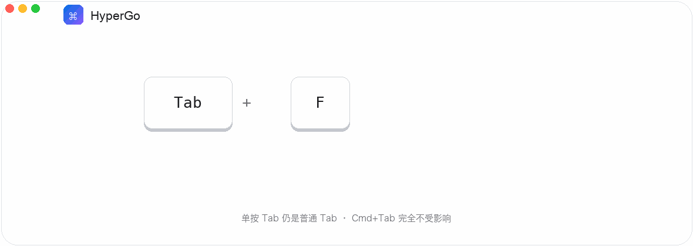
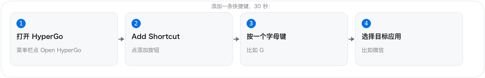

<div align="center">

[简体中文](./README.md) · **English** · [日本語](./README.ja.md) · [한국어](./README.ko.md) · [Русский](./README.ru.md)

# HyperGo

**One key. Every app.**

Turn `Tab` into a Hyper key — hold it, press a letter, and the app is there.

[](../../releases)
[](../../releases)
[](../../releases)

[Download latest](../../releases/latest) · [Quick start](#quick-start) · [FAQ](#faq)



</div>

---

## What is this

**The Hyper key**: hold `Tab` (left hand) or `\` (right hand), press a letter, and the target app launches or jumps to your current desktop — **across Spaces, in a single keystroke**.

- `Tab + F` for Finder, `Tab + S` for Safari
- No Cmd+Tab hunting, no Mission Control, no mouse
- **Tap Tab alone and it still types Tab; Cmd+Tab is untouched**

That's it. If you've seen the animation above, you already know how to use HyperGo.

## Features

- ⌨️ **Two bases, zero retraining**: `Tab` for the left hand, `\` for the right; tapped alone, both still type normally
- ✨ **Switches across Spaces**: the mapped app comes to your current desktop, wherever it lives
- 🪶 **Native & light**: pure Swift, a single event tap, menu-bar resident. No Electron, no daemon
- 🔇 **Fully silent**: no network requests, no telemetry, everything stays on your machine
- 🚀 **Launches at login**: listener and config ready before you are
- 💤 **Never blocks sleep**: your display still sleeps normally
- 🐱 **Bonus**: a desktop cat that keeps you company (see [below](#the-desktop-cat-bonus))

## Download & install

Grab `HyperGo-1.2.0.dmg` from the [**Releases page**](../../releases/latest).

<details>
<summary><b>First launch (important — unsigned beta)</b></summary>

This build is not notarized yet, so macOS needs one extra step (only once):

1. Open the DMG and drag **HyperGo** into **Applications**
2. **Right-click HyperGo → Open → Open** in Launchpad or Applications
3. If macOS says it can't verify the app, open **System Settings → Privacy & Security** and click **Open Anyway**

Or run one terminal command, then double-click normally:

```bash
xattr -cr /Applications/HyperGo.app
```

On first launch, grant the **Accessibility** permission (required to listen for keystrokes).

</details>

## Quick start

<div align="center">



</div>

An in-app tutorial walks you through all of this on first launch.

### Add a shortcut (30 seconds)

<div align="center">



</div>

Open HyperGo → click **Add Shortcut** → press a letter → pick the target app → done.
Then **hold Tab + the letter** anytime. Edit or delete shortcuts whenever you like.

### Starter bindings (ready out of the box)

Five bindings ship pre-mapped; the remaining 31 keys are yours:

| Keys | Opens | Keys | Opens |
|---|---|---|---|
| `Tab` + `F` | Finder | `\` + `C` | VS Code |
| `Tab` + `S` | Safari | `\` + `K` | Terminal |
| `Tab` + `N` | Notes | | |

### Menu bar

| Menu item | What it does |
|---|---|
| Open HyperGo | Open the shortcut configuration window |
| Listener: On/Off | Temporarily toggle the Hyper key listener |
| Show Tutorial | Replay the first-launch tutorial |
| Pet: On/Off | Recall / hide the desktop cat |
| Auto Leave | How long the cat waits before wandering off |
| Buy me a coffee ☕ | Tip the developer |
| Quit HyperGo | Quit |

## The desktop cat (bonus)

Beyond the menu bar, HyperGo sends a small cat to sit in the corner of your desktop while you work:
it opens its eyes when you hold Tab, and **waves its paw** whenever a shortcut fires. Ignore it for 20 seconds and it walks off the screen to rest — zero distraction, zero idle drain.

<div align="center">


</div>

- **Recall it**: menu bar → Pet: On
- **Leave timing**: menu bar → Auto Leave (10s / 20s / 30s / 60s / Never)
- **Move it**: just drag it; it snaps to screen edges

## Requirements

- macOS 13.0 or later
- Apple Silicon (M series) or Intel
- Accessibility permission (required for key listening — HyperGo never reads what you type, it only recognizes the Tab/backslash hold and your shortcut letters)

## FAQ

<details>
<summary><b>Hyper key stops working after a reboot?</b></summary>

Fixed in recent versions (config loads and listener starts at launch). If it still happens, toggle Listener off/on in the menu bar, and please file an Issue.
</details>

<details>
<summary><b>Display won't sleep?</b></summary>

An older version had this bug (video playback blocking sleep); it's fixed now. If it persists, file an Issue and mention your macOS version.
</details>

<details>
<summary><b>Does it read my keyboard input?</b></summary>

No. HyperGo only uses a system event tap to recognize "Tab/backslash held" and "which letter was pressed". It never records, stores, or uploads keystrokes, and runs fully offline with zero network requests.
</details>

<details>
<summary><b>How do I uninstall?</b></summary>

1. Menu bar → Quit HyperGo
2. System Settings → Login Items → remove HyperGo
3. Delete /Applications/HyperGo.app
4. (Optional) delete config: `~/Library/Application Support/HyperGo/`
</details>

## Known limitations

- Not notarized yet — first launch needs manual approval (see install steps above)
- Modifier keys are not customizable yet (fixed to Tab / `\`)
- The cat's transparent edges may look slightly off on some wallpapers

## Tech stack

SwiftUI + AppKit · AVFoundation · CGEvent Tap · Vision · zero third-party dependencies

---

## Feedback

- 🐛 **Found a bug?** → [File an Issue](../../issues/new/choose) — pick a template and fill it in (app version / chip / macOS version required)
- 💡 **Ideas & suggestions** → [Discussions](../../discussions)
- 📮 Every report gets read; progress is posted back in the Issue

<!-- Optional channels, uncomment when needed: feedback email / survey / WeChat group QR -->

## Support ☕

If HyperGo saved you time, consider buying the developer a coffee — every cup fuels the next update:

<p align="center">
  
</p>

---

<div align="center">

**If HyperGo is useful to you, please give it a Star ⭐**

*HyperGo · a home for every key*

*Built by one human, at a keyboard.*

</div>
