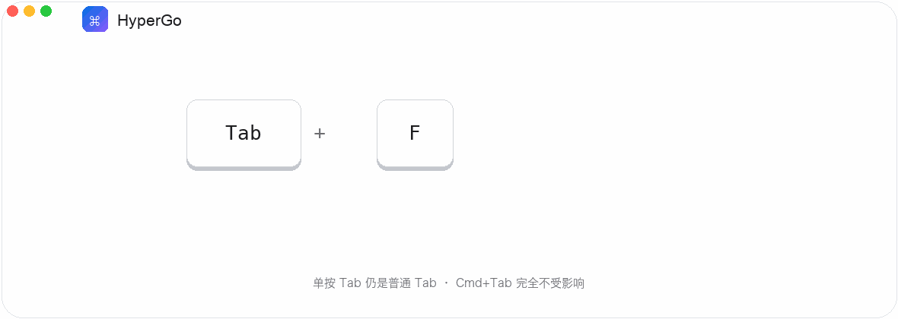
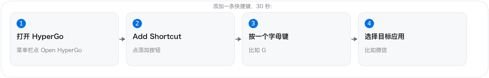
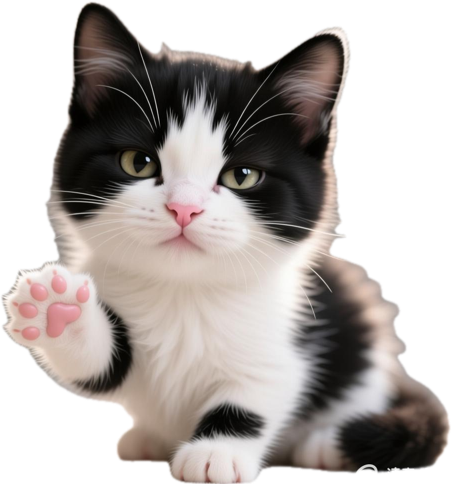

<div align="center">

[简体中文](./README.md) · [English](./README.en.md) · **日本語** · [한국어](./README.ko.md) · [Русский](./README.ru.md)

# HyperGo

**ひとつのキーで、すべてのアプリへ。**

`Tab` を Hyper キーに変える —— 押しながらアルファベットをひとつ叩くだけで、アプリが目の前に。

[](../../releases)
[](../../releases)
[](../../releases)

[最新版をダウンロード](../../releases/latest) · [クイックスタート](#クイックスタート) · [FAQ](#faq)



</div>

---

## これは何

**Hyper キー**：`Tab`（左手）または `\`（右手）を押し続けてアルファベットをひとつ叩くと、対象のアプリが起動、または今のデスクトップへ即座に呼び出されます —— **別の Space からでもワンストロークで**。

- `Tab + F` で Finder、`Tab + S` で Safari
- ⌘Tab で探す必要も、Mission Control も、マウスも不要
- **Tab の単体入力はそのまま。⌘Tab にも影響しません**

これだけです。上のアニメーションを見れば、もう HyperGo の使い方はわかっています。

## 主な機能

- ⌨️ **2 つのベースキー、学び直しゼロ**：左手は `Tab`、右手は `\`。単体で押せばどちらも通常どおり
- ✨ **スペース横断スイッチ**：アプリはどの Space にいても、現在のデスクトップへ呼ばれます
- 🪶 **ネイティブ & 軽量**：純 Swift、イベントタップ 1 つ、メニューバー常駐。Electron もデーモンもなし
- 🔇 **完全サイレント**：ネットワーク通信なし、テレメトリーなし、データはすべてローカルに
- 🚀 **ログイン時に自動起動**：リスナーと設定が起動前に準備完了
- 💤 **スリープを妨げない**：ディスプレイは通常どおりスリープします
- 🐱 **ボーナス**：一緒に働いてくれるデスクトップ猫（[下記](#デスクトップ猫ボーナス)）

## ダウンロードとインストール

[**Releases ページ**](../../releases/latest) から `HyperGo-1.2.0.dmg` をダウンロードしてください。

<details>
<summary><b>初回起動の方法（重要 — 未署名ベータのため）</b></summary>

このビルドは Apple の公証を受けていないため、初回だけひと手間必要です：

1. DMG を開き、**HyperGo** を**アプリケーション**フォルダにドラッグ
2. Launchpad またはアプリケーションで **HyperGo を右クリック → 開く → 開く**
3. 「検証できません」と表示されたら、**システム設定 → プライバシーとセキュリティ**を開き、**このまま開く**をクリック

または、ターミナルで以下のコマンドを実行してから通常どおりダブルクリック：

```bash
xattr -cr /Applications/HyperGo.app
```

初回起動時に**アクセシビリティ**権限を求められたら許可してください（キー入力のリッスンに必要）。

</details>

## クイックスタート

<div align="center">



</div>

初回起動時のチュートリアルが、アプリ内ですべてを案内します。

### ショートカットを追加（30 秒）

<div align="center">



</div>

HyperGo を開く → **Add Shortcut** をクリック → アルファベットをひとつ押す → 対象アプリを選ぶ → 完了。
あとはいつでも **Tab + アルファベット**で即呼び出し。追加・編集・削除はいつでも自由です。

### 初期バインド（すぐ使える）

5 つのバインドがあらかじめ設定済み。残り 31 キーはあなたのもの：

| キー | 呼び出し | キー | 呼び出し |
|---|---|---|---|
| `Tab` + `F` | Finder | `\` + `C` | VS Code |
| `Tab` + `S` | Safari | `\` + `K` | Terminal |
| `Tab` + `N` | Notes | | |

### メニューバー

| 項目 | 内容 |
|---|---|
| Open HyperGo | ショートカット設定ウィンドウを開く |
| Listener: On/Off | Hyper キーのリッスンを一時的に切り替え |
| Show Tutorial | 初回チュートリアルを再生 |
| Pet: On/Off | デスクトップ猫の呼び出し / 非表示 |
| Auto Leave | 猫が暇になると去るまでの時間 |
| 赏杯咖啡 ☕ | 開発者にコーヒーをおごる |
| Quit HyperGo | 終了 |

## デスクトップ猫（ボーナス）

メニューバー常駐のほかに、HyperGo はデスクトップの隅に小さな猫を送り込み、あなたの作業を見守ります：
Tab を押し続けると目を開き、ショートカットが成功すると**前足をパタパタ**。20 秒放置すると画面の外へ散歩に出かけます —— 邪魔もリソース消費もゼロ。

<div align="center">



</div>

- **呼び戻す**：メニューバー → Pet: On
- **去るまでの時間**：メニューバー → Auto Leave（10 秒 / 20 秒 / 30 秒 / 60 秒 / 永遠にいない）
- **場所を変える**：ドラッグするだけ。画面の端に近づくと自動でスナップ

## 必要環境

- macOS 13.0 以降
- Apple Silicon（M シリーズ）または Intel
- アクセシビリティ権限（キーのリッスンに必須。HyperGo は入力内容を読み取りません。「Tab / バックスラッシュの長押し」と「どのアルファベットが押されたか」を認識するだけです）

## FAQ

<details>
<summary><b>再起動すると Hyper キーが効かなくなる？</b></summary>

最近のバージョンで修正済み（起動時に設定を読み込み、リスナーも自動開始）。それでも発生する場合は、メニューバーの Listener をオフ/オンしてから、Issue をご報告ください。
</details>

<details>
<summary><b>ディスプレイがスリープしない？</b></summary>

旧バージョンにあった不具合（動画再生がスリープを妨げる）は修正済みです。それでも発生する場合は、macOS のバージョンを添えて Issue をご報告ください。
</details>

<details>
<summary><b>キー入力の内容を読まれますか？</b></summary>

いいえ。HyperGo はシステムのイベントタップで「Tab / バックスラッシュの長押し」と「どのアルファベットが押されたか」を認識するだけです。キーストロークの記録・保存・送信は一切なく、完全オフラインで動作します。
</details>

<details>
<summary><b>アンインストールの方法は？</b></summary>

1. メニューバー → Quit HyperGo
2. システム設定 → ログイン項目 → HyperGo を削除
3. /Applications/HyperGo.app を削除
4. （任意）設定ファイルを削除：`~/Library/Application Support/HyperGo/`
</details>

## 既知の制限

- 未公証 —— 初回起動時に手動での許可が必要（上記のインストール手順を参照）
- 修飾キーはまだカスタマイズできません（Tab / `\` 固定）
- 猫の透明な縁が、壁紙によってはわずかに不自然に見えることがあります

## 技術スタック

SwiftUI + AppKit · AVFoundation · CGEvent Tap · Vision · サードパーティ依存ゼロ

---

## フィードバック

- 🐛 **バグを見つけた？** → [Issue を報告](../../issues/new/choose)（テンプレートを選んで記入。アプリのバージョン / チップ / macOS バージョンが必須です）
- 💡 **アイデア・ご提案** → [Discussions](../../discussions)
- 📮 すべての報告に目を通し、進捗は Issue 内でお知らせします

<!-- Optional channels, uncomment when needed: feedback email / survey / WeChat group QR -->

## サポート ☕

HyperGo が時間を節約してくれたと感じたら、開発者にコーヒーをおごってみてください —— 一杯一杯が次のアップデートの原動力です：

<p align="center">
  
</p>

---

<div align="center">

**HyperGo が役に立ったら、Star ⭐ をおねがいします**

*HyperGo · すべてのキーに、行き先を。*

*一人の人間が、キーボードの前で作りました。*

</div>
