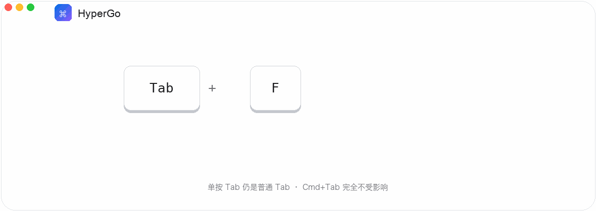
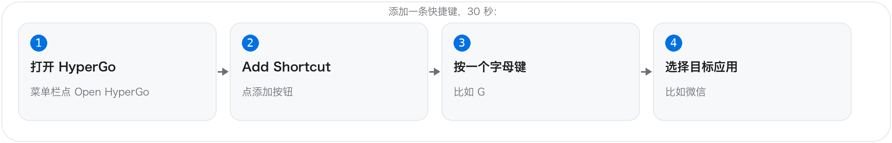

<div align="center">

[简体中文](./README.md) · [English](./README.en.md) · [日本語](./README.ja.md) · **한국어** · [Русский](./README.ru.md)

# HyperGo

**하나의 키로, 모든 앱으로.**

`Tab` 키를 Hyper 키로 바꿔드립니다 —— 누른 채 알파벳 하나를 누르면, 앱이 바로 열립니다.

[](../../releases)
[](../../releases)
[](../../releases)

[최신 버전 다운로드](../../releases/latest) · [빠른 시작](#빠른-시작) · [FAQ](#faq) · [☕ 후원](#후원)



</div>

---

## 이것은 무엇인가요

**Hyper 키**: `Tab`(왼손) 또는 `\`(오른손)을 길게 누른 채 알파벳 하나를 누르면, 대상 앱이 실행되거나 현재 데스크톱으로 즉시 불려옵니다 —— **다른 Space에 있어도 한 번의 입력으로**.

- `Tab + F`로 Finder, `Tab + S`로 Safari
- ⌘Tab으로 찾을 필요도, Mission Control도, 마우스도 필요 없습니다
- **Tab 단독 입력은 그대로, ⌘Tab도 영향을 받지 않습니다**

이게 전부입니다. 위의 애니메이션을 보셨다면, 이미 HyperGo를 쓰실 줄 아는 겁니다.

## 주요 기능

- ⌨️ **두 개의 베이스 키, 재적응 제로**: 왼손은 `Tab`, 오른손은 `\`. 단독 입력은 둘 다 일반 키 그대로
- ✨ **스페이스 간 전환**: 앱이 어느 Space에 있든 현재 데스크톱으로 불려옵니다
- 🪶 **네이티브 & 가벼움**: 순수 Swift, 이벤트 탭 하나, 메뉴 막대 상주. Electron도 데몬도 없음
- 🔇 **완전한 침묵**: 네트워크 요청 없음, 텔레메트리 없음, 모든 데이터는 로컬에만
- 🚀 **로그인 시 자동 시작**: 리스너와 설정이 시작 전에 준비됩니다
- 💤 **절전 방지 없음**: 디스플레이는 평소처럼 정상적으로 잠듭니다
- 🐱 **보너스**: 함께 일해주는 데스크톱 고양이([아래 참고](#데스크톱-고양이-보너스))

## 다운로드 및 설치

[**Releases 페이지**](../../releases/latest)에서 `HyperGo-1.2.0.dmg`를 받아주세요.

> 🇨🇳 중국에서는 **[Gitee 미러](https://gitee.com/hyperkeygo/HyperGo/releases)** 가 더 빠릅니다 (내용 동일)

<details>
<summary><b>첫 실행 방법 (중요 — 미서명 베타)</b></summary>

이 빌드는 아직 애플 공증을 받지 않았기 때문에, 첫 실행 시 한 단계가 더 필요합니다:

1. DMG를 열고 **HyperGo**를 **응용 프로그램** 폴더로 드래그
2. Launchpad 또는 응용 프로그램에서 **HyperGo 우클릭 → 열기 → 열기**
3. "확인할 수 없음"이라고 나오면 **시스템 설정 → 개인정보 보호 및 보안**에서 **하기로 열기** 클릭

또는 터미널에서 아래 명령어 한 줄 실행 후 평소처럼 더블클릭:

```bash
xattr -cr /Applications/HyperGo.app
```

첫 실행 시 **손쉬운 사용** 권한을 요청하면 허용해주세요 (키 입력 리스닝에 필요).

</details>

## 빠른 시작

<div align="center">



</div>

첫 실행 시 앱 내 튜토리얼이 전 과정을 안내합니다.

### 바로 가기 추가 (30초)

<div align="center">



</div>

HyperGo 열기 → **Add Shortcut** 클릭 → 알파벳 하나 입력 → 대상 앱 선택 → 완료.
그 후 언제든 **Tab + 알파벳**으로 즉시 호출. 추가·수정·삭제는 자유롭게.

### 기본 바인딩 (바로 사용 가능)

5개의 바인딩이 미리 설정되어 있고, 나머지 31키는 당신의 것:

| 키 | 호출 | 키 | 호출 |
|---|---|---|---|
| `Tab` + `F` | Finder | `\` + `C` | VS Code |
| `Tab` + `S` | Safari | `\` + `K` | Terminal |
| `Tab` + `N` | Notes | | |

### 메뉴 막대

| 항목 | 내용 |
|---|---|
| Open HyperGo | 바로 가기 설정 창 열기 |
| Listener: On/Off | Hyper 키 리스닝 임시 전환 |
| Show Tutorial | 첫 실행 튜토리얼 재생 |
| Pet: On/Off | 데스크톱 고양이 호출 / 숨기기 |
| Auto Leave | 고양이가 떠나기까지의 시간 |
| 赏杯咖啡 ☕ | 개발자에게 커피 사주기 |
| Quit HyperGo | 종료 |

## 데스크톱 고양이 (보너스)

메뉴 막대에 상주하는 것 외에도, HyperGo는 데스크톱 구석에 작은 고양이를 보내 당신의 작업을 지켜봅니다:
Tab을 누르고 있으면 눈을 뜨고, 바로 가기가 성공하면 **앞발을 흔듭니다**. 20초간 방치하면 화면 밖으로 산책을 나갑니다 —— 방해도, 리소스 낭비도 없습니다.

<div align="center">


</div>

- **불러오기**: 메뉴 막대 → Pet: On
- **떠나는 시간**: 메뉴 막대 → Auto Leave (10초 / 20초 / 30초 / 60초 / 영원히 안 떠남)
- **자리 옮기기**: 드래그만 하면 됩니다. 화면 가장자리에 가까워지면 자동으로 붙습니다

## 시스템 요구 사항

- macOS 13.0 이상
- Apple Silicon (M 시리즈) 또는 Intel
- 손쉬운 사용 권한 (키 리스닝에 필수. HyperGo는 입력 내용을 읽지 않습니다. "Tab/역슬래시 길게 누름"과 "어떤 알파벳이 눌렸는지"만 인식합니다)

## FAQ

<details>
<summary><b>재부팅 후 Hyper 키가 작동하지 않나요?</b></summary>

최근 버전에서 수정되었습니다 (시작 시 설정 로드, 리스너 자동 시작). 그래도 발생하면 메뉴 막대에서 Listener를 끄고 켠 뒤 Issue로 알려주세요.
</details>

<details>
<summary><b>디스플레이가 잠들지 않나요?</b></summary>

구버전의 버그(영상 재생이 절전을 막는 문제)는 수정되었습니다. 그래도 발생하면 macOS 버전과 함께 Issue로 알려주세요.
</details>

<details>
<summary><b>키보드 입력을 읽나요?</b></summary>

아니요. HyperGo는 시스템 이벤트 탭으로 "Tab/역슬래시를 길게 누름"과 "어떤 알파벳이 눌렸는지"만 인식합니다. 키 입력을 기록·저장·전송하지 않으며, 완전 오프라인으로 동작합니다.
</details>

<details>
<summary><b>삭제 방법은?</b></summary>

1. 메뉴 막대 → Quit HyperGo
2. 시스템 설정 → 로그인 항목 → HyperGo 제거
3. /Applications/HyperGo.app 삭제
4. (선택) 설정 삭제: `~/Library/Application Support/HyperGo/`
</details>

## 알려진 제한 사항

- 미공증 —— 첫 실행 시 수동 승인 필요 (위의 설치 단계 참고)
- 한정 키(모디파이어)는 아직 커스텀 불가 (Tab / `\` 고정)
- 일부 배경화면에서 고양이의 투명 가장자리가 약간 어색해 보일 수 있습니다

## 기술 스택

SwiftUI + AppKit · AVFoundation · CGEvent Tap · Vision · 서드파티 의존성 제로

---

## 피드백

- 🐛 **버그를 발견하셨나요?** → [Issue 제보](../../issues/new/choose) (템플릿을 골라 작성. 앱 버전 / 칩 / macOS 버전 필수)
- 💡 **아이디어 & 제안** → [Discussions](../../discussions)
- 📮 모든 제보를 꼼꼼히 읽고, 진행 상황은 Issue에서 알려드립니다

<!-- Optional channels, uncomment when needed: feedback email / survey / WeChat group QR -->

## 후원 ☕

HyperGo가 시간을 아껴주었다면, 개발자에게 커피 한 잔을 사주는 것도 좋습니다 —— 모든 잔이 다음 업데이트의 원동력입니다:

<p align="center">
  
</p>

---

<div align="center">

**HyperGo가 유용하다면 Star ⭐를 눌러주세요**

*HyperGo · 모든 키에, 그 자리를.*

*한 사람이 키보드 앞에서 만들었습니다.*

</div>
