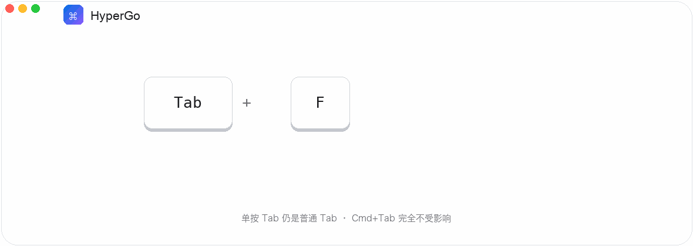
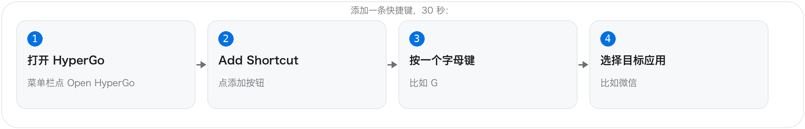

<div align="center">

**简体中文** · [English](./README.en.md) · [日本語](./README.ja.md) · [한국어](./README.ko.md) · [Русский](./README.ru.md)

# HyperGo

**一键，直达所有应用。**

把 `Tab` 变成 Hyper 键 —— 按住它，再按一个字母，应用即刻就位

[](../../releases)
[](../../releases)
[](../../releases)

[下载最新版](../../releases/latest) · [三步上手](#三步上手) · [常见问题](#常见问题) · [☕ 赞助支持](#赞助支持)



</div>

---

## 这是什么

**Hyper 键**：按住 `Tab`（左手）或 `\`（右手），再按一个字母，目标应用启动或瞬间跳到你当前的桌面——**跨 Space 也是一次按键完成**。

- `Tab + F` 一秒切到 Finder，`Tab + S` 切到 Safari
- 不用 Cmd+Tab 翻找，不用 Mission Control，不用碰鼠标
- **单按 Tab 仍是普通 Tab，Cmd+Tab 完全不受影响**

就这么多。看完上面那张动图，你已经会用 HyperGo 了。

## 功能特性

- ⌨️ **双基键，零适应成本**：左手 `Tab`、右手 `\`；单按任何一个，都仍是普通按键
- ✨ **跨空间切换**：无论目标应用在哪个桌面空间，一次按键唤到眼前
- 🪶 **原生轻量**：纯 Swift、单个事件监听、常驻菜单栏。无 Electron、无后台守护进程
- 🔇 **完全静默**：无网络请求、无数据上传、无遥测，所有数据只存在本地
- 🚀 **开机自启**：登录项自动启动，监听自动开启，配置自动加载
- 💤 **不挡熄屏**：不会阻止屏幕正常休眠
- 🐱 **还有彩蛋**：一只会陪你工作的桌面小猫（见[下文](#桌面小猫彩蛋)）

## 下载安装

前往 [**Releases 页面**](../../releases/latest) 下载 `HyperGo-1.2.0.dmg`。

> 🇨🇳 国内下载更快：**[Gitee 发行版](https://gitee.com/hyperkeygo/HyperGo/releases)**（内容与 GitHub 完全一致）

<details>
<summary><b>首次打开方法（重要，请看这里）</b></summary>

当前版本未做苹果公证，首次打开需要多一步操作（仅需一次）：

1. 打开 DMG，将 **HyperGo** 拖入 **Applications** 文件夹
2. 在启动台或 Applications 中**右键点击 HyperGo → 打开 → 打开**
3. 如果提示"无法验证"，请打开 **系统设置 → 隐私与安全性**，滚动到下方点击 **仍要打开**

或者，在终端执行一条命令后正常双击打开：

```bash
xattr -cr /Applications/HyperGo.app
```

首次启动会请求**辅助功能**权限（监听键盘必需），请在系统设置中允许。

</details>

## 三步上手

<div align="center">



</div>

首次启动时，应用内教程会带你完整走一遍。

### 添加快捷键（30 秒）

<div align="center">



</div>

打开 HyperGo → 点「Add Shortcut」→ 按一个字母键 → 选择目标应用 → 完成。
之后 **按住 Tab + 字母** 即可瞬间唤起，可随时修改或删除。

### 预置快捷键（开箱即用）

首次启动已预置五条快捷键，其余 31 个键位等你定义：

| 按键 | 直达 | 按键 | 直达 |
|---|---|---|---|
| `Tab` + `F` | Finder | `\` + `C` | VS Code |
| `Tab` + `S` | Safari | `\` + `K` | Terminal |
| `Tab` + `N` | Notes | | |

### 菜单栏图标

| 菜单项 | 作用 |
|---|---|
| Open HyperGo | 打开快捷键配置窗口 |
| Listener: On/Off | 临时开关 Hyper 键监听 |
| Show Tutorial | 重新播放新手教程 |
| Pet: On/Off | 召回/隐藏桌面小猫 |
| Auto Leave | 小猫闲置自动离场的时长 |
| 赏杯咖啡 ☕ | 请作者喝杯咖啡 |
| Quit HyperGo | 退出 |

## 桌面小猫（彩蛋）

HyperGo 常驻菜单栏之外，还会派一只小猫趴在你桌面右下角陪你工作：
你按住 Tab 的时候它会睁眼，成功唤起应用时它会**拍爪庆祝**；20 秒不理它，它自己起身走出屏幕去休息——零打扰，零资源占用。

<div align="center">


</div>

- **召唤回来**：菜单栏 → Pet: On
- **离场时长**：菜单栏 → Auto Leave（10s / 20s / 30s / 60s / 永不）
- **换个位置**：直接用鼠标拖，靠近屏幕边缘会自动贴边

## 系统要求

- macOS 13.0 及以上
- Apple Silicon (M 系列) 或 Intel 芯片
- 辅助功能权限（监听键盘必需，本工具不读取按键内容，只识别 Tab 和快捷键字母）

## 常见问题

<details>
<summary><b>重启电脑后 Hyper 键失效？</b></summary>

新版本已修复（配置随启动自动加载、监听自动开启）。如果仍遇到，点菜单栏 Listener 关闭再打开即可，并欢迎提 Issue。
</details>

<details>
<summary><b>屏幕无法熄屏？</b></summary>

旧版本存在此问题（视频播放阻止熄屏），新版本已修复。若仍遇到，请提 Issue 并注明 macOS 版本。
</details>

<details>
<summary><b>会读取我的键盘输入吗？</b></summary>

不会。HyperGo 只使用系统事件监听识别"Tab/反斜杠按下"和"哪个字母键按下"，不记录、不存储、不上传任何按键内容。应用完全离线运行，无任何网络请求。
</details>

<details>
<summary><b>如何卸载？</b></summary>

1. 菜单栏 → Quit HyperGo
2. 系统设置 → 登录项 → 移除 HyperGo
3. 删除 /Applications/HyperGo.app
4. （可选）删除配置：`~/Library/Application Support/HyperGo/`
</details>

## 已知限制

- 未做苹果公证，首次打开需手动允许（见上方安装说明）
- 暂不支持自定义修饰键（目前固定为 Tab / `\`）
- 桌面小猫的透明边缘在部分壁纸下可能略有不自然

## 技术栈

SwiftUI + AppKit · AVFoundation · CGEvent Tap · Vision · 无第三方依赖

---

## 反馈与建议

- 🐛 **遇到 Bug** → [提交 Issue](../../issues/new/choose)，选个模板照着填就行（版本 / 芯片 / 系统三项必填，定位问题快很多）
- 💡 **想法与建议** → [Discussions 讨论区](../../discussions)，功能畅想、使用心得，随便聊
- 📮 每一条反馈都会认真看，修复进度也会在 Issue 里同步

<!-- 可选渠道，需要时取消注释：反馈邮箱 / 问卷链接 / 微信群二维码 -->

## 赞助支持 ☕

如果 HyperGo 帮你省下了时间，可以考虑请作者喝杯咖啡——每一杯都是继续更新的动力：

<p align="center">
  
</p>

---

<div align="center">

**如果觉得好用，请给个 Star ⭐**

*HyperGo · 让每个按键都有归属*

*一个人、一把键盘做出来的产品。*

</div>
