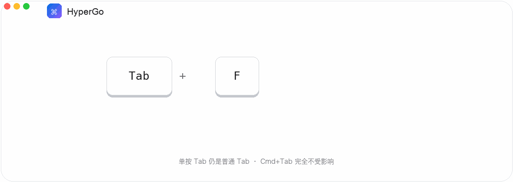
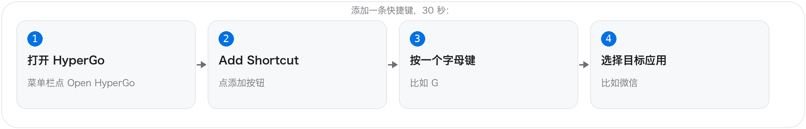

<div align="center">

[简体中文](./README.md) · [English](./README.en.md) · [日本語](./README.ja.md) · [한국어](./README.ko.md) · **Русский**

# HyperGo

**Одна клавиша. Любое приложение.**

HyperGo превращает `Tab` в Hyper-клавишу — удерживайте её, нажмите букву, и приложение уже здесь.

[](../../releases)
[](../../releases)
[](../../releases)

[Скачать последнюю версию](../../releases/latest) · [Быстрый старт](#быстрый-старт) · [FAQ](#faq) · [☕ Поддержать](#поддержка)



</div>

---

## Что это

**Hyper-клавиша**: удерживайте `Tab` (левая рука) или `\` (правая) и нажмите букву — целевое приложение запустится или мгновенно переместится на ваш текущий рабочий стол — **даже из другого Space, одним нажатием**.

- `Tab + F` — Finder, `Tab + S` — Safari
- Без перебора в ⌘Tab, без Mission Control, без мыши
- **Одиночный Tab работает как раньше. ⌘Tab не затрагивается**

Это всё. Если вы видели анимацию выше — вы уже умеете пользоваться HyperGo.

## Возможности

- ⌨️ **Две базовые клавиши, ноль переучивания**: `Tab` для левой руки, `\` для правой; одиночное нажатие работает как обычно
- ✨ **Переключение между Space**: приложение приходит на ваш текущий стол, откуда бы оно ни было
- 🪶 **Нативно и легко**: чистый Swift, один event tap, живёт в строке меню. Без Electron и демонов
- 🔇 **Полная тишина**: никаких сетевых запросов и телеметрии, все данные остаются локально
- 🚀 **Запуск при входе**: слушатель и настройки готовы до вас
- 💤 **Не мешает сну**: экран засыпает как обычно
- 🐱 **Бонус**: кот на рабочем столе, который работает вместе с вами (см. [ниже](#кот-на-рабочем-столе-бонус))

## Загрузка и установка

Скачайте `HyperGo-1.2.0.dmg` со [**страницы Releases**](../../releases/latest).

<details>
<summary><b>Первый запуск (важно — неподписанная бета)</b></summary>

Эта сборка ещё не нотаризована, поэтому macOS потребует один дополнительный шаг (только один раз):

1. Откройте DMG и перетащите **HyperGo** в папку **Программы**
2. **Правый клик на HyperGo → Открыть → Открыть** в Launchpad или Программах
3. Если macOS сообщит, что не может проверить приложение, откройте **Системные настройки → Конфиденциальность и безопасность** и нажмите **Открыть в любом случае**

Либо выполните одну команду в терминале и запускайте обычным двойным кликом:

```bash
xattr -cr /Applications/HyperGo.app
```

При первом запуске разрешите доступ **Универсального доступа** (нужен для прослушивания клавиш).

</details>

## Быстрый старт

<div align="center">



</div>

Встроенный туториал проведёт вас по всем шагам при первом запуске.

### Добавить сочетание (30 секунд)

<div align="center">



</div>

Откройте HyperGo → нажмите **Add Shortcut** → нажмите букву → выберите приложение → готово.
Дальше в любой момент **удерживайте Tab + буква**. Добавляйте, меняйте и удаляйте сочетания свободно.

### Начальные привязки (работают из коробки)

Пять привязок настроены заранее; остальные 31 клавиши — ваши:

| Клавиши | Открывает | Клавиши | Открывает |
|---|---|---|---|
| `Tab` + `F` | Finder | `\` + `C` | VS Code |
| `Tab` + `S` | Safari | `\` + `K` | Terminal |
| `Tab` + `N` | Notes | | |

### Строка меню

| Пункт | Действие |
|---|---|
| Open HyperGo | Открыть окно настройки сочетаний |
| Listener: On/Off | Временно включить/выключить слушатель Hyper-клавиши |
| Show Tutorial | Повторить обучающий ролик |
| Pet: On/Off | Вернуть / скрыть кота |
| Auto Leave | Через сколько кот уходит гулять |
| 赏杯咖啡 ☕ | Купить разработчику кофе |
| Quit HyperGo | Выйти |

## Кот на рабочем столе (бонус)

Помимо строки меню, HyperGo посылает маленького кота в угол вашего рабочего стола:
он открывает глаза, когда вы удерживаете Tab, и **машет лапой** при каждом срабатывании сочетания. Не обращайте на него внимания 20 секунд — он уйдёт за край экрана отдыхать. Ноль отвлечений, ноль расхода ресурсов.

<div align="center">


</div>

- **Вернуть**: строка меню → Pet: On
- **Время ухода**: строка меню → Auto Leave (10 с / 20 с / 30 с / 60 с / никогда)
- **Переместить**: просто перетащите; у краёв экрана он прилипает автоматически

## Требования

- macOS 13.0 или новее
- Apple Silicon (серия M) или Intel
- Разрешение Универсального доступа (нужно для прослушивания клавиш — HyperGo не читает, что вы печатаете: она распознаёт только удержание Tab/backslash и нажатую букву сочетания)

## FAQ

<details>
<summary><b>Hyper-клавиша перестаёт работать после перезагрузки?</b></summary>

Исправлено в свежих версиях (конфигурация загружается, слушатель стартует автоматически при запуске). Если проблема осталась — выключите и включите Listener в строке меню и создайте Issue.
</details>

<details>
<summary><b>Экран не засыпает?</b></summary>

В старой версии был такой баг (воспроизведение видео мешало сну); он исправлен. Если повторяется — создайте Issue и укажите вашу версию macOS.
</details>

<details>
<summary><b>Читает ли программа мои нажатия клавиш?</b></summary>

Нет. HyperGo использует системный event tap только для распознавания «удержания Tab/backslash» и «какая буква нажата». Нажатия не записываются, не сохраняются и не отправляются — приложение работает полностью офлайн, без единого сетевого запроса.
</details>

<details>
<summary><b>Как удалить программу?</b></summary>

1. Строка меню → Quit HyperGo
2. Системные настройки → Объекты входа → удалите HyperGo
3. Удалите /Applications/HyperGo.app
4. (По желанию) удалите настройки: `~/Library/Application Support/HyperGo/`
</details>

## Известные ограничения

- Без нотаризации — первый запуск требует ручного подтверждения (см. шаги установки выше)
- Модификаторы пока не настраиваются (зафиксированы Tab / `\`)
- Прозрачные края кота на некоторых обоях могут выглядеть слегка неестественно

## Технологии

SwiftUI + AppKit · AVFoundation · CGEvent Tap · Vision · ноль сторонних зависимостей

---

## Обратная связь

- 🐛 **Нашли баг?** → [Создать Issue](../../issues/new/choose) — выберите шаблон и заполните (версия приложения / чип / версия macOS обязательны)
- 💡 **Идеи и предложения** → [Discussions](../../discussions)
- 📮 Каждое сообщение читается; прогресс публикуется прямо в Issue

<!-- Optional channels, uncomment when needed: feedback email / survey / WeChat group QR -->

## Поддержка ☕

Если HyperGo сэкономила вам время, угостите разработчика кофе — каждая чашка приближает следующее обновление:

<p align="center">
  
</p>

---

<div align="center">

**Если HyperGo полезна — поставьте Star ⭐**

*HyperGo · у каждой клавиши есть своё место*

*Сделано одним человеком, за клавиатурой.*

</div>
